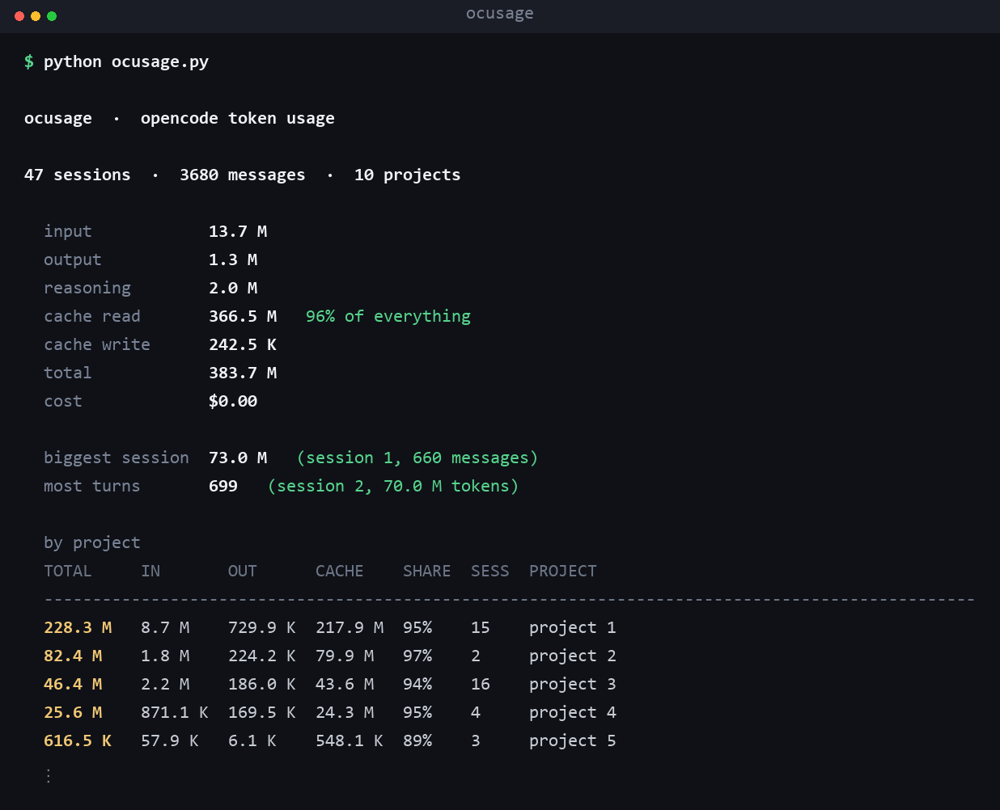

# ocusage


What your OpenCode sessions actually cost, read straight from the local database.

The usage panel shows the session you are in right now. It forgets everything when you close it. `opencode.db` does not — every session, every model, every turn, since you installed it.



<sub>Project and session names are replaced with numbers. The token counts are real.</sub>

## What it tells you that the panel does not

- **Which project eats your quota.** One repo can be 60% of everything you have ever spent.
- **Cache share.** If it is 95%, almost all of your tokens are re-read context, not new work. That is the number that explains a surprise bill.
- **The session that got away.** Sorted by tokens, so the 73 M one is not a mystery any more.
- **Which day it happened.** `--by day` turns "I used it a lot this week" into a number.

## Usage

```bash
python ocusage.py                    # everything, grouped by project
python ocusage.py --since 7d         # last week only
python ocusage.py --since 2026-11-01
python ocusage.py --by session       # the expensive ones, biggest first
python ocusage.py --by day
python ocusage.py --by model
python ocusage.py --by agent
python ocusage.py --top 30
python ocusage.py --json             # for scripting
python ocusage.py --db path/to/opencode.db
```

`--since` takes `24h`, `7d`, `2w`, `3m`, or a date.

## `/usage` inside OpenCode

```bash
python ocusage.py --install-command
```

That writes `usage.md` into `~/.config/opencode/command/` with the path to this script already filled in. Restart OpenCode, then `/usage`, `/usage --since 7d`, or `/usage --by session` runs it and shows the table.

## Where the numbers come from

`~/.local/share/opencode/opencode.db`, opened **read only**. `session_v2` already stores per-session `cost`, `tokens_input`, `tokens_output`, `tokens_reasoning`, `tokens_cache_read`, `tokens_cache_write`, `model` and `agent`, so there is no estimating and no API calls.

Nothing leaves the machine. No network, no telemetry, no config file.

If the path is somewhere else, set `OPENCODE_DB` or pass `--db`.

## Cost is often zero

Free models report `cost = 0`, so a $0.00 total is correct, not a bug. Paid models fill it in.

## Tests

```bash
python test_ocusage.py
```

They build a throwaway database in temp and check the token maths, the date filter, project fallback, model name parsing and the grouping totals. Your real database is only ever opened read only.

## Limits

- Python 3.9+, no dependencies.
- It reads what OpenCode recorded. If a session was compacted, the tokens are what was billed, not what you remember typing.
- Tool-level attribution is not in the schema, so it cannot say which tool burned the context. Only which session, project, model and day.
